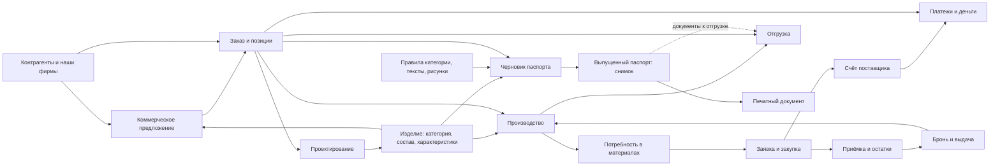

# Общая карта «Работа с сайтом» — проект для обсуждения

Не новый экран: расширение существующей #help. Уже есть дорожки процессов в help-guide-data.js:222–273 и отдельная карта продукции в help-product-map.js:19–56. Общая карта должна связать эти два представления.
Ниже начальная смысловая схема, не утверждение обо всех автоматических переходах серверного кода.

## Как сотрудник читает карту
Три режима: «Что с чем связано», «Как выполнить работу», «Что изменится». Одна схема, выбранная карточка подсвечивает только ближайшие связи.
Блок показывает обычное название, краткое назначение и кнопку «Открыть». Нажатие сначала раскрывает пояснение рядом; отдельная кнопка ведёт в раздел.
Сплошная стрелка — источник данных; пунктир — следующий шаг сотрудника. Снимок помечен замком и словами «зафиксировано при выпуске».
На узких экранах — последовательный список связей, как у текущей карты продукции. Доступность разделов учитывает роль.

## Карточка выбранной сущности
| Поле | Пример для изделия |
|---|---|
| Что это | Общая модель, которую используем в разных заказах |
| Откуда сведения | Категория, конструктор, состав, файлы |
| Где используется | КП, позиции заказа, производство, черновики паспортов |
| Что изменится | Связанные черновики могут взять новые общие сведения |
| Что сохранится | Выпущенные паспорта сохраняют снимок; для изменения нужна новая редакция |
| Где исправить | Карточка изделия → нужный блок |

Для остальных узлов влияние должно быть подтверждено кодом перед публикацией. Нельзя показывать переход процесса как автоматическое копирование данных.

## Сценарии поверх карты
1. Продать: контрагент → КП → заказ → позиции → производство/закупка → отгрузка → расчёты.
2. Закупить: потребность → заявка → поставщик/счёт → оплата → приёмка → бронь/выдача.
3. Подготовить изделие: категория → характеристики → состав/файлы → правила паспорта → проверка.
4. Выпустить паспорт: изделие + позиция заказа → недостающие сведения → предпросмотр → выпуск → PDF.
5. Исправить: выбрать сущность → увидеть связанные документы → выбрать обновление черновика или новую редакцию.

## Приёмка карты
Сотрудник по снимку может назвать источник значения, место исправления и затрагиваемые документы. Все стрелки подписаны.
Проверить выбор изделия, заказа, заявки, платежа, выпущенного паспорта; отсутствие доступа; телефон и широкий экран.
Согласовать по трём снимкам: общая схема, выделенное изделие, выделенный выпущенный паспорт. Разработка пока не начата.
